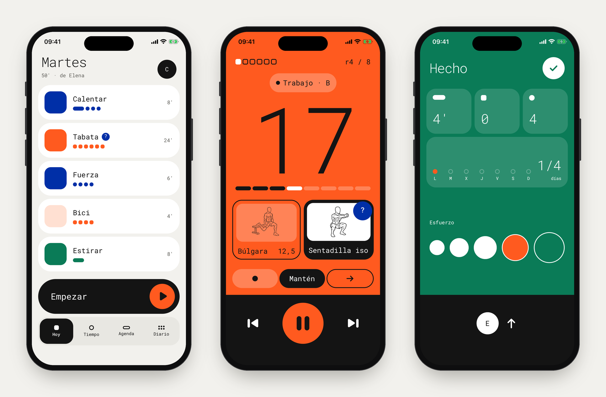
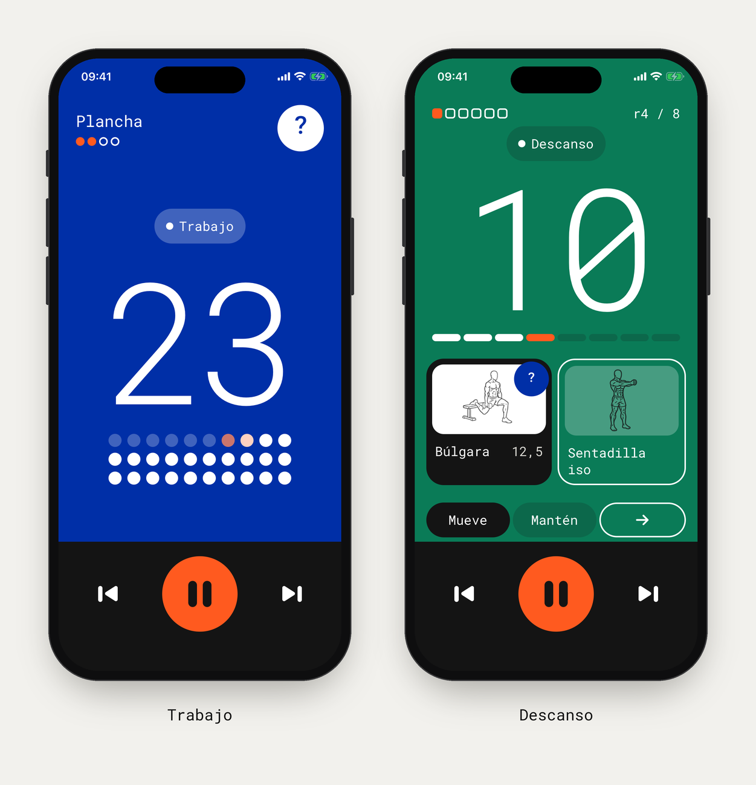
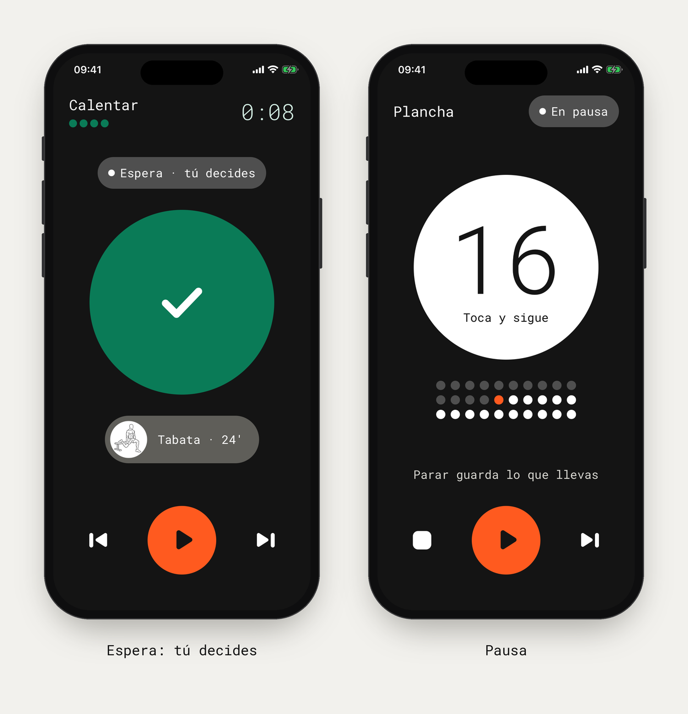
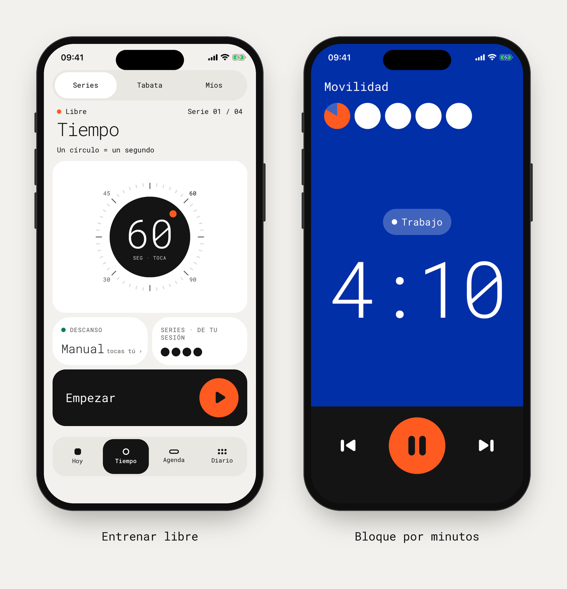
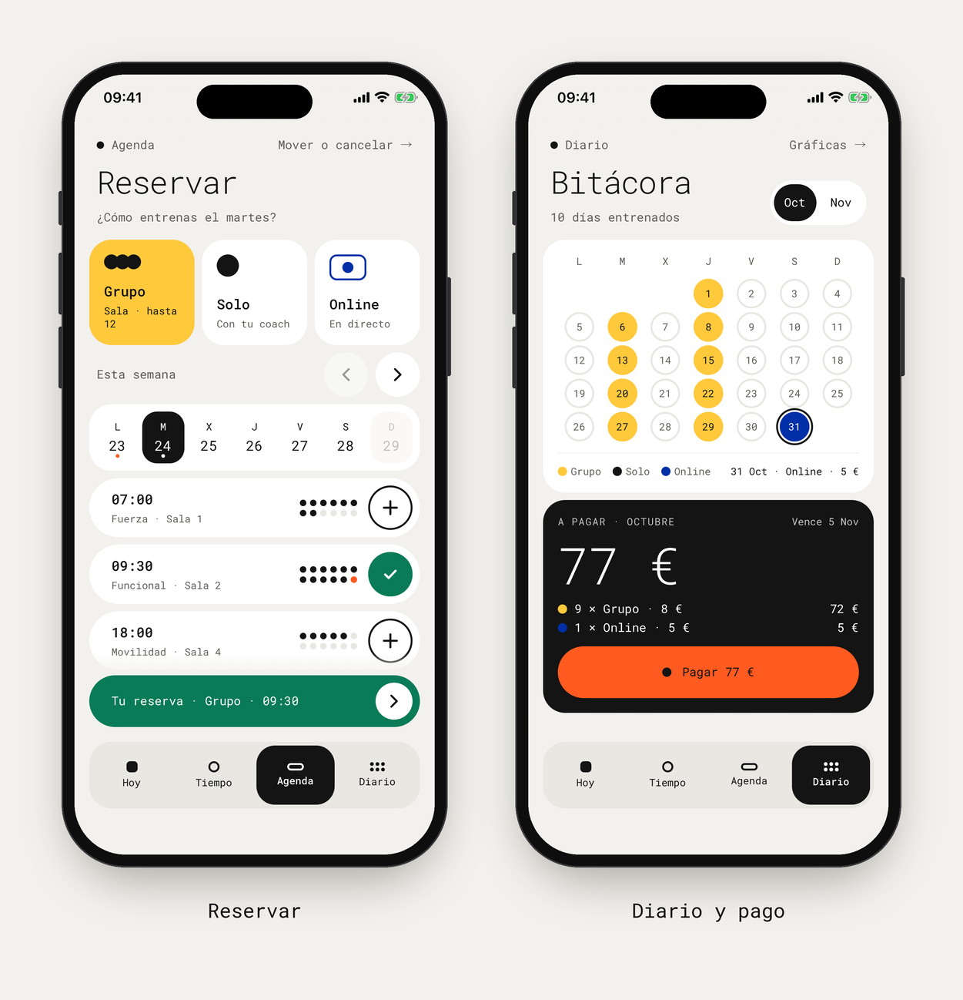
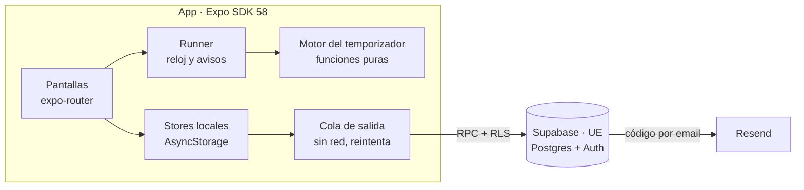

<div align="center">

# KRAFT

**La app del atleta. El entrenador manda la sesión hecha; tú solo tocas.**

El círculo es la unidad: un segundo, una serie, una ronda.

[Probar en el navegador](https://kraft.olmedcr.workers.dev) · [Diseño](design/) · [Auditoría](docs/auditoria-2026-11-22.md)



</div>

---

## Para quién

Para alguien cansado, con el móvil en el suelo y música puesta, que mira un segundo y vuelve al ejercicio. Por eso la pantalla en marcha enseña un número grande, un color que dice en qué estás y un solo mando abajo. Lo demás no cabe.

## Tres reglas

| | Regla | En la práctica |
| --- | --- | --- |
| 1 | **Un número, una regla** | Cifras en escala Fibonacci (233 · 144 · 89 · 55 · 34), espacio en 4 · 8 · 12 · 16 · 24 · 32 · 48 · 64. Toques de 48 a 280 pt. Ningún valor fuera de [`design/tokens`](design/tokens/tokens.json). |
| 2 | **Color = estado** | Klein `#002FA7` trabajo · verde `#0A7B57` descanso y hecho · naranja `#FF5A1F` actuar y Tabata · tinta `#141414` espera y pausa. Siempre con una palabra al lado: nunca solo color. |
| 3 | **En marcha, un solo mando** | Barra de 144 en tinta: anterior · central naranja · siguiente. Toda la palma del centro pausa; los bordes no. |

Tipografía única: Roboto Mono 300/400/500. Iconos redondeados, sin emoji.

## Pantallas

<table>
<tr>
<td width="50%"></td>
<td width="50%"></td>
</tr>
<tr>
<td><b>Tramos.</b> Un punto por segundo. El fondo cambia con la fase y suena un pitido largo al empezar y acabar.</td>
<td><b>Espera y pausa.</b> En espera sigues cuando quieras; en pausa aparece «Parar», que guarda lo hecho.</td>
</tr>
<tr>
<td></td>
<td></td>
</tr>
<tr>
<td><b>Entrenar libre.</b> Series, Tabata (20/10, 30/15, 40/20) o tus temporizadores guardados.</td>
<td><b>Agenda y diario.</b> Reservas en grupo, solo u online; el diario suma el mes y se paga desde ahí.</td>
</tr>
</table>

Las 50 pantallas del diseño, con su captura a 390×844, están en [`design/png`](design/png).

## Qué hace

| Recorrido | Qué cubre |
| --- | --- |
| **Primera vez** | Bienvenida con aceptación y edad, acceso con código por email, vincular entrenador con su código de 6 cifras, permisos y una pantalla para aprender la palma. |
| **Sesión del día** | Bloques de tramos, Tabata y escalera (series con peso). 3·2·1, trabajo, descanso fijo o espera manual, pausa y resumen con esfuerzo para el entrenador. |
| **No sé el ejercicio** | «?» abre cómo se hace con ilustración en tres fases, y el tiempo sigue corriendo. |
| **Reservar** | Semana a semana, plazas en puntos, lista de espera, cambiar o cancelar (con aviso de cargo). |
| **Entrenar libre** | Series de 30/45/60/90 s con descanso manual o fijo, Tabata y temporizadores propios. |
| **Diario y pago** | Calendario del mes, importe por modalidad, pago, recibo por email y exportar tus datos en CSV. |
| **Tú y legal** | Sonido, avisos, entrenador, cuenta, privacidad, salud con consentimiento propio y borrado de cuenta a 30 días. |

**Durante la marcha:** sigue en segundo plano, mantiene la pantalla encendida, baja la música en vez de pararla y, con el móvil bloqueado, programa avisos locales con sonido para cada cambio de tramo. Si la app se cierra a mitad, al volver ofrece retomar, empezar de cero o terminar ahí. Funciona sin red: lo hecho se guarda y se envía al volver la conexión.

## Arquitectura



- **Motor del temporizador** ([`src/timer/engine.ts`](src/timer/engine.ts)): estado puro y transiciones (`start`, `pauseToggle`, `prev`, `next`, `end`…) sobre un plan de tramos. Sin React ni reloj propio: se prueba con Jest a cualquier hora simulada. El runner ([`runner.ts`](src/timer/runner.ts)) le da la hora de pared, que no se desfasa si el sistema duerme la app.
- **Sesión** ([`src/session`](src/session)): valida y compila lo que manda el entrenador (bloques, tramos, repeticiones, peso) en el plan del motor. El cierre se apunta al acabar la marcha, no al tocar ✓.
- **Sincronización** ([`src/sync`](src/sync), [`src/backend`](src/backend)): la app escribe primero en local y encola el envío (reservas, pagos, entrenos, desvincular). Si el servidor rechaza algo, se explica en lenguaje llano.
- **Servidor** ([`supabase/migrations`](supabase/migrations)): tablas con Row Level Security y funciones `security definer` para lo sensible (vincular entrenador con límite de intentos, reservar, exportar datos, borrar cuenta).
- **Tema** ([`src/theme`](src/theme)): generado desde [`design/tokens/tokens.json`](design/tokens/tokens.json). Si un valor no está en los tokens, es un error.

## Estructura

```
src/
  app/           rutas (expo-router): (tabs), alta, sesion, reserva, pago, tu, legal
  features/      pantallas por recorrido: hoy, sesion, tiempo, agenda, diario, alta, tu, legal
  components/    Mando, Palma, AnilloPuntos, FilaBloque, BarraAccion, PildoraFase, Navegacion…
  timer/         motor, runner, sonido y voz
  session/       tipos, validación, compilación y cierre de la sesión
  agenda/ diario/ alta/ legal/   modelos y stores de cada dominio (con tests)
  backend/ sync/ cliente Supabase, autenticación, cola de salida
  platform/      avisos, vibración, anuncios para lector de pantalla
  theme/         tokens → tema
design/          50 pantallas + 6 tableros (HTML), capturas PNG y tokens
supabase/        migraciones, plantilla del email y config
scripts/         semilla, rutina de demo, prueba remota y tests de base de datos
```

## Empezar

Requisitos: Node 22.18 o superior (los scripts ejecutan TypeScript directamente), Xcode con simulador de iOS o Android Studio, y Expo Go o un build de desarrollo.

```bash
npm install
```

```bash
npx expo start
```

**Modo demo.** Sin `.env.local` la app arranca sin servidor, con datos de ejemplo en el móvil (Elena, martes de 50', 42 €). Sirve para probar todos los recorridos sin cuenta.

**Con servidor.** Copia [`.env.example`](.env.example) a `.env.local` y rellena la URL y la clave pública de tu proyecto de Supabase. La clave de servicio y la de Resend solo se usan desde el ordenador en los scripts: nunca van en la app ni en git.

### Comandos

| Comando | Qué hace |
| --- | --- |
| `npm test` | Tests de Jest: motor del temporizador, sesión, agenda, diario, alta, legal y sincronización. |
| `npm run typecheck` | TypeScript estricto. |
| `scripts/db/test.sh` | Aplica las migraciones en un Postgres temporal (sin Docker) y corre [`tests.sql`](scripts/db/tests.sql): RLS, reservas, vincular, límites. |
| `node --env-file=.env.local scripts/semilla.ts` | Crea a Elena (entrenadora), sus clases de dos semanas y la sesión de grupo. Se puede repetir. |
| `node --env-file=.env.local scripts/rutina-demo.ts <email> [días]` | Pone una rutina de demo con los tres tipos de bloque a un atleta. |
| `node --env-file=.env.local scripts/probar-remoto.ts` | Prueba de humo contra el servidor real con dos atletas de usar y tirar. |

### Despliegue

**Base de datos:**

```bash
supabase db push
```

**Web** (Cloudflare Workers, recursos estáticos; [`wrangler.jsonc`](wrangler.jsonc)):

```bash
npx expo export -p web && npx wrangler deploy
```

**Móvil:** perfiles `development`, `preview` y `production` en [`eas.json`](eas.json).

## Diseño

La fuente de verdad está en el repo:

- [`design/screens`](design/screens): las 50 pantallas y los tableros de sistema exportados del lienzo, con medidas exactas. `K1Components` (componentes), `K2Sitemap`, `K3Journeys` y `K5Audit` (reglas de pulido) mandan.
- [`design/png`](design/png): captura de cada pantalla a 390×844 para comparar.
- [`design/tokens`](design/tokens): colores, cifras, texto, espacio, radios, toques y movimiento.

## Accesibilidad

- Nada en marcha por debajo de 18 pt; toques de 48 pt como mínimo y 104 pt para la acción principal.
- Cada fase se anuncia al lector de pantalla («Trabajo, 30 segundos», «En pausa»); el mando tiene acciones con nombre (mantener para pausar, tramo anterior).
- Respeta «Reducir movimiento» en vivo. Texto dinámico hasta 1,5× salvo las cifras grandes.
- En web: teclado (espacio pausa, flechas cambian de tramo), foco visible y región `aria-live`.

La revisión completa, con lo arreglado y lo pendiente, está en [`docs/auditoria-2026-11-22.md`](docs/auditoria-2026-11-22.md).

## Privacidad

Pensada para el RGPD (España). Servidor en la UE. Analítica y emails apagados por defecto. La salud tiene consentimiento propio y solo escribe entrenos y calorías. Puedes descargar tus datos en CSV y borrar la cuenta (se hace en 30 días; los recibos se guardan lo que pide la ley). El texto legal final está pendiente de abogado.

## Estado

v1 en desarrollo, probada en el simulador de iPhone y en web. El pago es simulado hasta conectar una pasarela.

Pendiente de un build nativo:

- Live Activity y pantalla de bloqueo con número y pausa.
- Congelar la marcha durante una llamada.
- Probar vibración y VoiceOver en un iPhone real, y Android entero.

Fuera de v1: el lado del entrenador, widget y Apple Watch.

## Créditos

Ilustraciones de ejercicios: **Workout Guide · Bryl Lim / Everkinetic**, [CC BY-SA 4.0](https://creativecommons.org/licenses/by-sa/4.0/). El crédito también se ve dentro de la app (Tú → Cuenta → Créditos de ilustración).

Los datos de ejemplo (Elena, sus clases y precios) son de relleno.
